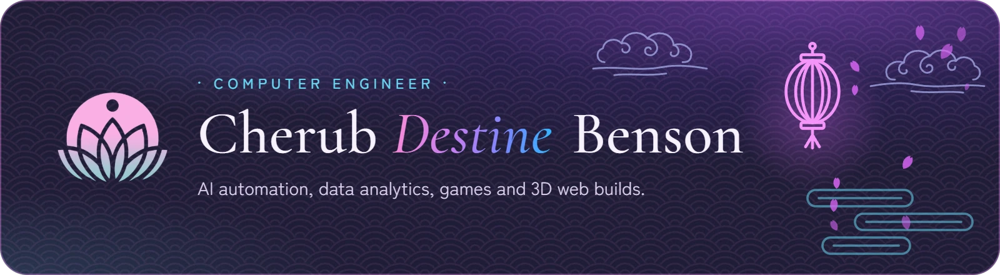
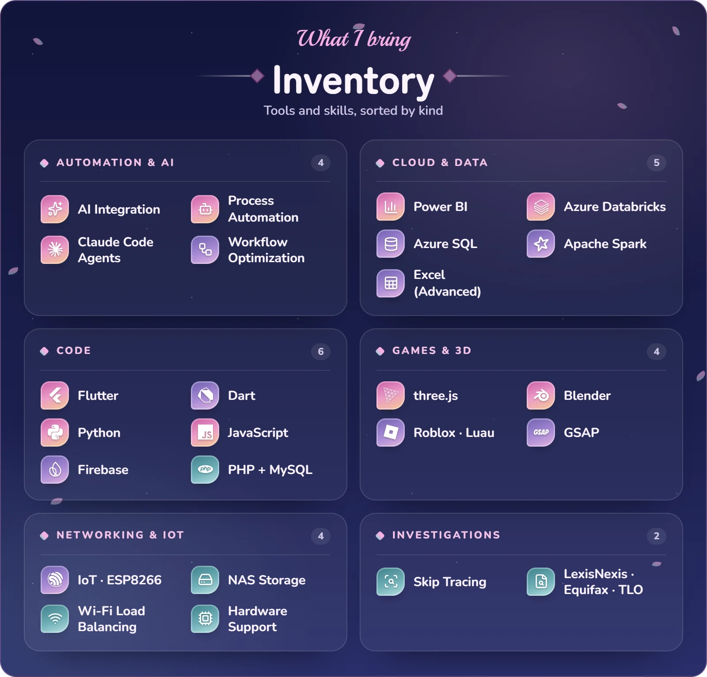

<!-- Blossom-festival profile. Panels are inverted on purpose: GitHub dark mode shows the light panels,
     light mode shows the dark ones. Dividers follow the page so they stay visible. -->
<picture><source media="(prefers-color-scheme: dark)" srcset="assets/banner-light.webp"></picture>

  <a href="https://discord.com/users/271138859603984385"><picture><source media="(prefers-color-scheme: dark)" srcset="https://lanyard.cnrad.dev/api/271138859603984385?theme=light&bg=FDFAF5&borderRadius=18px"></picture></a>
  <a href="https://github.com/Ventixz"><picture><source media="(prefers-color-scheme: dark)" srcset="https://streak-stats.demolab.com/?user=Ventixz&card_width=410&card_height=210&border_radius=18&background=135%2CFDFAF5%2CF4E8F6&hide_border=true&stroke=E8AEC4&ring=FF8DD5&fire=B05F98&currStreakNum=1B1C31&sideNums=1B1C31&currStreakLabel=A3127F&sideLabels=45425F&dates=65617F"></picture></a>

<picture><source media="(prefers-color-scheme: dark)" srcset="assets/divider-dark.png"></picture>

<picture><source media="(prefers-color-scheme: dark)" srcset="assets/skills-day.webp"></picture>

<picture><source media="(prefers-color-scheme: dark)" srcset="assets/divider-dark.png"></picture>

<h3 align="center">· Socials ·</h3>

  
  
  
  
  
  

